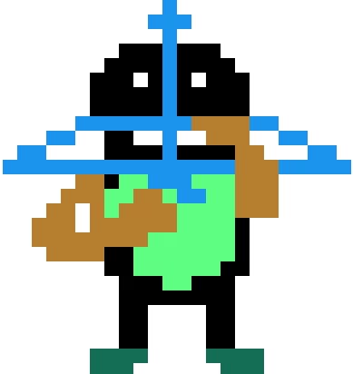
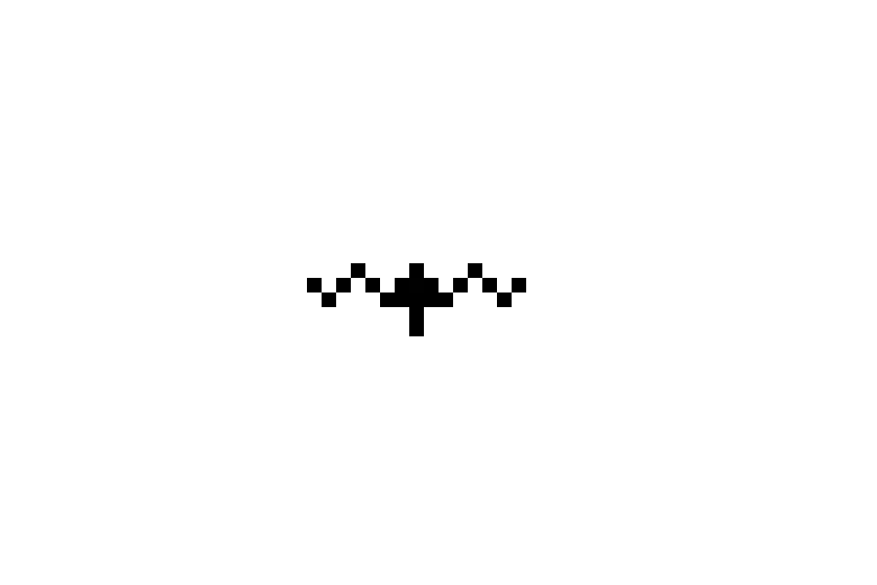
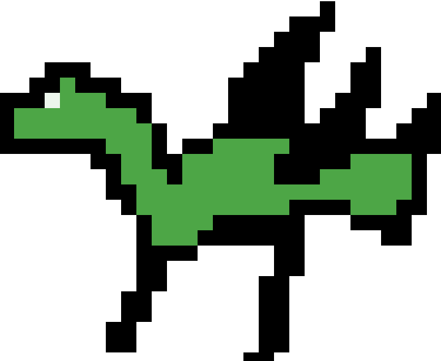

# Demon War

<p align="center">
  
  &nbsp;&nbsp;&nbsp;
  
  &nbsp;&nbsp;&nbsp;
  
</p>

<p align="center">
  A real-time 2D combat prototype built in Rust with ggez.
</p>

<p align="center">
  <a href="https://www.rust-lang.org/"></a>
  <a href="https://ggez.rs/"></a>
  <a href="LICENSE"></a>
</p>

## Overview

Demon War is a single-player arena game prototype centered on movement, weapon switching, enemy-specific combat, and timed abilities. The hero fights a homing bat, a charging dinosaur, and a web-casting spider inside a fixed 1920 × 1080 battlefield. Each opponent has its own movement and collision behavior, while the player can alternate between ranged and melee combat, block damage, teleport, and recover health.

The project is also a compact example of building a game loop with ggez: it contains real-time input handling, sprite rendering, gravity, hitboxes, health meters, cooldowns, simple enemy AI, projectile combat, and state-driven drawing.

> **Project status:** Demon War is an early gameplay prototype. The core combat systems are present, but there is currently no menu, scoring system, sound, win screen, restart flow, or packaged release.

## Highlights

- Two combat styles: upward-firing arrows and a short-range knife.
- Three distinct enemies with homing, charging, and trapping behavior.
- Shield, teleport, and healing abilities with independent five-second recharge timers.
- Collision-based damage, health bars, enemy resets, and player defeat handling.
- Gravity for the hero, dinosaur, and falling spider net.
- Randomized aerial enemy spawn positions.
- Sprite-based rendering backed by a complete set of local PNG resources.

## Gameplay

The hero begins near the center of the arena with **150 HP**. Survive by moving around the battlefield, choosing the correct weapon for each enemy, and timing abilities around their cooldowns.

- Use arrows to attack the bat and spider from below.
- Switch to the knife when the bat or dinosaur enters the displayed melee radius.
- Avoid contact with the bat and the dinosaur; both deal collision damage.
- Escape the spider's falling net before it completely encloses the hero.
- Activate the shield before a collision, or teleport away from immediate danger.

Enemies reset instead of being permanently removed, creating an ongoing survival loop. When the hero reaches zero HP, the hero and all active enemies are hidden and the session ends.

## Controls

| Input | Action |
| --- | --- |
| `A` | Move left by 80 px |
| `D` | Move right by 80 px |
| `W` | Jump/move upward by 200 px |
| `S` | Move downward by 80 px, up to ground level |
| `Left Ctrl` | Toggle between bow/arrow mode and knife mode |
| Left mouse button | Fire an arrow in ranged mode |
| Left mouse button on an enemy | Attack it in knife mode when it is inside the melee radius |
| `Q` | Activate the shield when charged |
| `E` | Arm teleport when charged |
| Right mouse button | Teleport to the cursor after teleport has been armed |
| `F` | Activate the healing ultimate when charged |

Movement is disabled while the hero is fully enclosed by a spider net. Ability keys and weapon switching remain available.

## Characters and Combat Stats

The values below come directly from the current implementation in `src/state/play.rs`.

| Entity | HP | Size | Movement / behavior | Combat interaction |
| --- | ---: | --- | --- | --- |
| **Hero** | 150 | 95 × 120 | Player-controlled; gravity pulls the hero toward ground level at `y = 840` | Fires arrows, uses a knife, and activates three abilities |
| **Bat** | 50 | 80 × 80 | Spawns at a random aerial position and continuously homes toward the hero using DDA-style movement | Deals 10 contact damage; takes 25 damage from an arrow or knife hit |
| **Dinosaur** | 50 | 140 × 120 | Charges left at 2.5 units per update and wraps to its starting position after leaving the screen | Deals 18.75 contact damage; takes 25 damage from knife hits |
| **Spider** | 50 | 80 × 80 | Patrols horizontally and reverses direction near the arena edges | Takes 25 damage from arrows and drops a net every four seconds |
| **Spider net** | — | 200 × 150 | Falls at 6 units per update until ground level | Immobilizes the hero while the hero's hitbox is fully contained by the net |
| **Arrow** | — | 2 × 60 hitbox | Travels straight upward at 15.5 units per update | Damages bats and spiders; disappears on impact or after leaving the screen |

Enemy health is restored when an enemy is defeated. The bat returns to a random aerial location, the dinosaur returns to its starting point, and the spider's combat state is reset.

## Weapons

### Bow and arrow

Ranged mode is active when the game starts. A left click creates a new upward-moving projectile from the hero's position. Arrows can damage the bat and spider, and multiple arrows may exist at the same time.

### Knife

Press `Left Ctrl` to enter melee mode. The game draws a 140 px attack radius around the hero. To land a hit, the target must be inside that radius and the player must left-click the target itself. Knife attacks currently affect the bat and dinosaur.

## Abilities

Each ability begins uncharged and becomes available after five seconds. The three abilities track their cooldowns independently.

| Key | Ability | Current behavior |
| --- | --- | --- |
| `Q` | **Shield** | Surrounds the hero with a translucent barrier for five seconds and prevents bat and dinosaur contact damage while active |
| `E` | **Teleport** | Arms a teleport; right-clicking then moves the hero to the cursor and consumes the charge |
| `F` | **Healing ultimate** | Starts the prototype's health-recovery routine and consumes the charge when the routine completes |

The ability icons are displayed along the bottom of the 1920 × 1080 window. The current build does not yet show a numeric or visual cooldown overlay, so an ability key has an effect only after its timer has charged.

## Enemy Systems

### Bat: homing pressure

The bat uses the difference between its position and the hero's position to calculate a DDA-style step every update. This gives it continuous pursuit in both axes. On contact it damages the hero, then receives a small positional knockback so the collision does not remain perfectly static.

### Dinosaur: ground charge

The dinosaur continuously crosses the lower part of the arena from right to left. Contact deals the largest single enemy hit in the current build. The dinosaur is deliberately a melee target: arrows do not damage it, so the hero must enter knife range.

### Spider: area denial

The spider patrols overhead and releases a large falling net every four seconds. Once a net fully contains the hero's hitbox, standard movement input is locked. The spider itself is a ranged target and can be hit with arrows.

## Health and Collision Model

- All actors use axis-aligned rectangles for primary collision checks.
- Knife range is evaluated as a 140 px circle around the hero.
- Health meters appear when an entity becomes involved in combat.
- Damage is capped at the target's remaining HP, preventing health from falling below zero through a single hit.
- The active shield blocks bat and dinosaur contact damage.
- Gravity adds 6 units per update until an affected object reaches the ground boundary.

## Resource Catalogue

All visual resources live in [`resources/`](resources). The game rescales source images at draw time, so source resolution and in-game size are intentionally different.

| Resource | Source resolution | Used for | Runtime status |
| --- | ---: | --- | --- |
| [`resources/copy_hero.png`](resources/copy_hero.png) | 389 × 412 | Hero holding the ranged weapon | Active |
| [`resources/hero_knife.png`](resources/hero_knife.png) | 405 × 361 | Hero in knife mode | Active |
| [`resources/hero.png`](resources/hero.png) | 960 × 640 | Alternate/original hero artwork | Present but not loaded by the current game state |
| [`resources/bat.png`](resources/bat.png) | 242 × 81 | Homing bat enemy | Active |
| [`resources/dinosaur.png`](resources/dinosaur.png) | 721 × 591 | Charging dinosaur enemy | Active |
| [`resources/spider.png`](resources/spider.png) | 84 × 96 | Patrolling spider enemy | Active |
| [`resources/spider net.png`](resources/spider%20net.png) | 382 × 307 | Falling immobilization net | Active |
| [`resources/shield_800.png`](resources/shield_800.png) | 451 × 454 | Shield ability icon | Active |
| [`resources/teleport.png`](resources/teleport.png) | 350 × 298 | Teleport ability icon | Active |
| [`resources/heal_ulti.png`](resources/heal_ulti.png) | 650 × 544 | Healing ultimate icon | Active |

The repository also contains Windows `Zone.Identifier` metadata files for several downloaded images. The tracked metadata names Piskel for the dinosaur download and Pixilart for the knife-hero, shield, teleport, and healing-icon downloads. These files are not read by the game, do not identify a specific creator or asset license, and have no effect on gameplay.

## Technology

- **Rust 2021** — game and systems implementation
- **ggez 0.6** — windowing, event loop, input, graphics, images, and geometry
- **glam 0.18** — vector construction and coordinate conversion
- **nalgebra 0.32** — point math used by melee-range checks
- **rand 0.8.5** — randomized bat and spider positions

Dependency versions are pinned in `Cargo.lock` for reproducible builds.

## Project Structure

```text
demon-war/
├── Cargo.toml              # Package metadata and dependencies
├── Cargo.lock              # Locked dependency graph
├── LICENSE                 # MIT license
├── README.md               # Project documentation
├── resources/              # Character, enemy, net, and ability artwork
└── src/
    ├── main.rs             # Window configuration and game startup
    └── state/
        ├── mod.rs          # State module exports
        ├── play.rs         # Gameplay, rendering, input, AI, and collisions
        └── pause.rs        # Reserved for a future pause state
```

## Getting Started

### Prerequisites

- A recent stable Rust toolchain installed through [rustup](https://rustup.rs/)
- A desktop environment capable of opening a 1920 × 1080 game window
- Native development packages required by ggez and its audio/windowing dependencies

On Debian or Ubuntu, the commonly required native packages can be installed with:

```bash
sudo apt update
sudo apt install -y pkg-config libasound2-dev libudev-dev
```

Native package names may differ on other Linux distributions. Windows and macOS users should follow the platform setup guidance in the [ggez documentation](https://ggez.rs/).

### Clone and build

```bash
git clone https://github.com/praniil/demon-war.git
cd demon-war
cargo build
```

### Important: configure resource paths

The current prototype loads its PNG files using the original developer's absolute paths in `PlayState::new`. Before running on another machine, replace this prefix in `src/state/play.rs`:

```text
/home/pranil/rustProjects/demon_war/resources/
```

with the absolute path to this repository's `resources` directory. If the paths are not updated, startup will panic when the game attempts to read the first sprite.

Then launch the game:

```bash
cargo run --release
```

The application opens a fixed **1920 × 1080** window titled **demon war**.

## Current Limitations

This repository represents an experimental build, and the following constraints are useful to know before extending it:

- Resource locations are hard-coded absolute paths rather than ggez resource paths.
- The arena and UI are designed for a fixed 1920 × 1080 resolution.
- Several frame-based movement values are not normalized using delta time, so speed may vary with update rate.
- The healing ultimate is still prototype logic and does not yet provide a polished, clearly bounded heal animation or UI state.
- There is no pause implementation yet; `src/state/pause.rs` is currently empty.
- There is no game-over message, restart command, score, persistent progression, audio, or automated test suite.
- Some legacy imports, comments, and downloaded-file metadata remain in the repository.

## Roadmap Ideas

- Move resources to ggez's portable resource filesystem.
- Add a title screen, pause state, game-over screen, and restart flow.
- Add visible cooldown indicators and ability-ready feedback.
- Normalize movement and cooldown behavior with frame delta time.
- Add sound effects, music, hit feedback, and animation states.
- Introduce score, waves, difficulty scaling, and enemy spawn management.
- Add automated tests for damage, cooldown, collision, and health logic.
- Package platform-specific releases through CI.

## Contributing

Contributions are welcome. For a focused change:

1. Fork the repository and create a feature branch.
2. Keep gameplay behavior and documentation in sync.
3. Run `cargo fmt` and `cargo check` before submitting changes.
4. Open a pull request describing the behavior changed and how it was tested.

When contributing artwork, include its origin and confirm that the project has permission to redistribute it.

## License

The source code is available under the [MIT License](LICENSE). Third-party or externally sourced artwork may be subject to its original creator's terms; verify asset rights before redistributing the resource files commercially.

---

Created by **Pranil Parajuli**.
